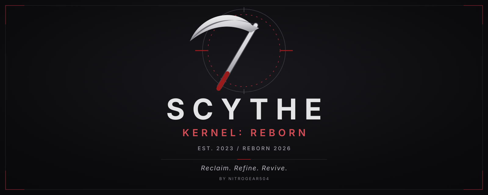

<p align="center">
  
</p>

<p align="center">
  <strong>Reclaim. Refine. Revive.</strong><br>
  A custom Linux kernel for the Realme 5, maintained by NitroGear504.
</p>

<p align="center">
  
  
  
  
</p>

## The return of Scythe

Scythe began in 2023 as a personal kernel project for the Realme 5. Its [original AnyKernel3 repository](https://github.com/NitroGear504/anykernel3) still carries the original name and ASCII banner.

Reborn in 2026, Scythe continues that idea on a new development foundation derived from Stormbreaker r5x and Linux OpenELA. The focus is practical memory efficiency, responsiveness and reliability on older hardware. This is a successor project, not a restoration of the original 2023 kernel source.

## Device and build information

| Item | Details |
| --- | --- |
| Device | Realme 5 (RMX1911 / r5x) |
| SoC | Qualcomm Snapdragon 665 |
| Tested hardware | 4 GB RAM variant |
| Kernel base | Linux 4.14.357-openela |
| Toolchain | Android Clang 20.0.0 (r547379) |
| Package | AnyKernel3, Image.gz-dtb |
| Development branch | `16.0-mem-opt-m7` |

Other device variants and ROM configurations have not been validated. The installer enforces RMX1911 compatibility; that check is not a guarantee of compatibility with every ROM.

## Features inherited from the stable baseline

- Multi-Gen LRU (MGLRU) and Pressure Stall Information (PSI).
- Native 4 GiB zRAM with Zstandard compression and a metadata allocation fallback.
- Tuned memory reclaim watermarks and swappiness.
- Deadline I/O scheduler and power-efficient workqueues.
- Camera device information registration fix.
- AnyKernel3 payload validation, conditional recovery backups and strict device checking.
- Automated builds, ZIP integrity checks and SHA-256 verification.

The M7 branch changes branding and release tooling, not the functional kernel configuration. Its new kernel release string still requires build and device validation. Performance and battery gains have not been established by controlled comparative benchmarks.

## Downloads and installation

[Stormbreaker r5x v1.0 — stable baseline](https://github.com/NitroGear504-1/android_kernel_realme_r5x/releases/tag/v1.0-r5x)

The first Scythe-branded development build is not yet device-validated. Use the stable baseline for recovery and keep its checksum and package available.

For a compatible RMX1911 configuration, back up important data and the current boot image, verify the downloaded ZIP against its SHA-256 sidecar, install via compatible custom recovery, and reboot. No data wipe is required. If a build fails to boot, use the known-good backup or the verified baseline in recovery. Do not flash on unverified devices.

## Building from source

Use a Linux build environment with the dependencies listed in [the CI workflow](.github/workflows/r5x-build.yml) and the pinned Android Clang toolchain used by that workflow. Build from a clean, committed working tree.

```bash
export CLANG_DIR="$HOME/toolchain/clang20"
./scripts/r5x-build.sh "$PWD/out-m7-clang20"
./scripts/r5x-package.sh "$PWD/out-m7-clang20"
```

The scripts verify the source commit, compiled image checksum, package integrity and ASCII banner inclusion. GitHub Actions also builds the M7 branch and uploads the configuration, build log, flashable ZIP and checksum.

## Development roadmap

| Milestone | Focus | Status |
| --- | --- | --- |
| M6 | First stable release (Stormbreaker v1.0) | Complete |
| M7 | Scythe Reborn identity | In progress |
| M8 | Magisk and application compatibility | Planned |
| M9 | Advanced profiling and compiler evaluation | Planned |
| M10 | Second stable release | Planned |
| M11 | CPU scheduling optimization | Planned |
| M12 | Memory pressure and app retention | Planned |
| M13 | Storage latency | Planned |
| M14 | Combined performance and power validation | Planned |
| M15 | Third stable release | Planned |

See [CHANGELOG.md](CHANGELOG.md) for development history.

## Credits and licensing

Maintained by **NitroGear504** ([current GitHub account](https://github.com/NitroGear504-1)).

Thanks to the original Stormbreaker developers and contributors, xevan (Bifrost installer heritage), the Linux and OpenELA communities, Qualcomm and Android kernel contributors, MGLRU developers and backport contributors, osm0sis and AnyKernel3 contributors, and LLVM/Android Clang developers. Existing source notices and upstream licenses remain authoritative; see [COPYING](COPYING), the original [Linux README](README), and [AnyKernel licensing](AnyKernel/LICENSE).
